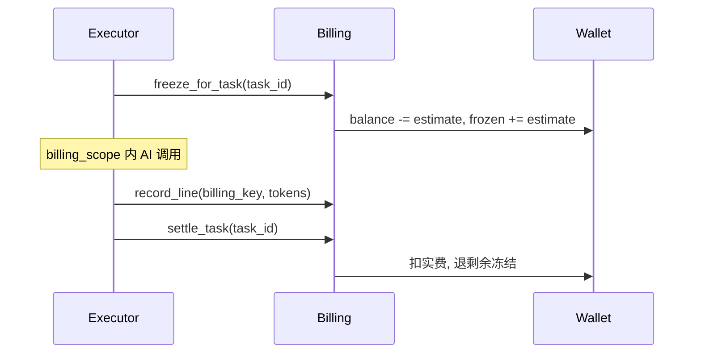

# PRINTFILM 计费说明

## 原则

- 按上游 **真实 TokenFree 成本**（或无法拿到 usage 时的保守估价）计费。
- 用户支付价 = TokenFree 官方成本，**不再加价**。
- 钱包单位：**分（fen）**。
- 充值：易支付 [pay.gitcc.com](https://pay.gitcc.com/)，支付宝 `alipay` / 微信 `wxpay`。
- **所有 AI 调用**均关联 `task_run_id`（单次聊天/API/工具调用创建轻量 TaskRun）。
- 本地按时长估算的视频 tokens 使用 `tokens_estimated` 标记，不能被识别为上游实测用量；实际费用仍优先取上游账单。
- 画布视频下载中断时保留原上游任务号，按退避策略重试获取成片，不重新创建视频生成请求；超过重试上限后保留原任务号供排查。
- 任务执行中断回收由 `TASK_RUNTIME_MAX_RECOVERIES` 限制，默认第三次中断即失败，前两次安排恢复；调度扫描和执行器停机中断共用累计次数。失败按实际已发生用量结算后退回剩余冻结金额（如冻结 100 分、已用 30 分，只退 70 分），不会忽略已发生费用直接全退；费用待核对的音色请求仍保留冻结。
- 漫剧 `episode_compose` 仅在本地统一编码、拼接已有视频，不调用 AI，估价和实扣均为 0；不依赖上游价目、不冻结钱包，也不受其他付费排队任务的余额承诺限制。浏览器正常无损拼接路径保留，编码不兼容才使用后台任务；任务不提供中途取消，离页不会停止后台合成。

## 公式

用户钱包不足由本站钱包校验的专用异常识别，HTTP 返回 402 与 `insufficient_balance`；上游模型账户或认证故障使用独立服务错误，不引导用户向本站钱包充值。本次仅区分错误来源，估价、冻结与结算算法不变。

**有上游成本时（优先）**：

```
charge_fen = cost_fen
```

**按 token 估价时**：

```
charge_fen = ceil(tokens / 1e6 * provider_yuan_per_m * 100)
```

默认成本价（元/百万 tokens，可环境覆盖）：

| billing_key | 成本 |
|-------------|------|
| seedance2:video0 | 46 |
| seedance2:video1 | 28 |
| llm_chat | 5 |
| seedream | 8（按次折合约；有上游费用则优先） |
| tts | 2（按次估价） |

### TokenFree / New API（quota 计费）

上游统一走 TokenFree。单次调用若返回 `usage.quota` / `quota_consumed`，按 New API 额度折人民币：

```
cost_fen = ceil(quota / 500000 × BILLING_USD_CNY × 100)   # 500000 quota = 1 USD
charge_fen = cost_fen
```

`BILLING_USD_CNY` 默认 **7.3**，与 TokenFree 控制台一致。价目 `billing_expr` 里常见系数已含 `/7.3` 折美元，本站兑回人民币必须用同一汇率，否则会系统性少扣约 4%。

### Seedance（对齐 TokenFree Ark 渠道导出）

渠道公式（2026-10-15）：

```
billing_expr USD sell = official_CNY / 7.3 * 1.5
本站人民币 = official_CNY × 1.5
```

火山刊例（元/百万 tokens，写入 `billing_expr` 的分子）：

| 模型 | 480p/720p 无视频 | 1080p 无视频 | 含视频输入 |
|------|------------------|--------------|------------|
| seedance-2.5 | 70 | 77 | 42 / 46（1080p） |
| seedance-2.0 | 46 | 51 | 28 / 31（1080p） |
| seedance-2.0-fast | 37 | — | 22 |

无上游 `tokens` 时按输出像素估：`tok/s ≈ W×H×24/1024`（480p≈1万、720p≈2.2万、1080p≈4.9万）。本站将 TF 导出的完整 `billing_expr` 固化进 `tokenfree_pricing.SEEDANCE_TF_BILLING_EXPR`，启动拉价后强制覆盖 Seedance 三条，避免公开 `/api/pricing` 漂移。`seedance-2.0-mimi`（笔误）与 mini 一并规范到 `seedance-2.0`。

对照：5s · 1080p · 2.5 · 无视频 ≈ 24.5 万 tok × 77 × 1.5 / 1e6 ≈ **¥28.3**（预扣再 ×`billing_estimate_buffer`）。

未返回 quota 时，结算前再查 New API 消费日志 `GET /api/log/self`（type=2）。能按模型、token 或上游任务号唯一对上的，用该条 `quota` 实扣（已含分组倍率）。对不上则按公开价目 `GET /api/pricing` 核实后的规则报价，分组倍率按 1：

- `billing_mode=tiered_expr`：任务表达式（含 `u("seconds")` 等）结果就是美元；token 表达式系数是美元/百万 tokens
- `quota_type=1`：`model_price` 美元/次
- 其余：`model_ratio` / `completion_ratio`（`model_ratio=1` 为 2 美元/百万 tokens）

`model_ratio=37.5` 且没有表达式时仍视为占位，视频回退本站秒价表，不要拿 37.5 当秒价。价目未收录时，生图才回退 Kie 积分档。

管理端「支付与计费」可「查询 TokenFree 余额」（`GET /v1/dashboard/billing/subscription` + `usage`），并拉取公开价目展示推荐模型官方价。

预扣：生图 API 按逻辑模型路由解析出的上游模型名原样调用 TokenFree（如渠道启用的 `gpt-image-2` / `gpt-image-2.5` / `seedream-5-0-pro`，不做硬改写；`gpt-image-2-5` 等历史写法规范到 `gpt-image-2.5`）。价目里有按次价或表达式时，预扣与结算都用该规则（例如 `gpt-image-2` 的 `model_price`），价目键会互查点分/连字符。价目缺失时 **gpt-image / sunburst** 才按 Kie 积分档保底（1K 6 / 2K 10 / 4K 16 积分；默认 3.5 分/积分）。**按张官价不再乘 `billing_estimate_buffer`（默认 1.2）**。LLM / 视频 / TTS 估价仍乘缓冲。视频有 `billing_expr` 时按表达式（分辨率 × 秒，默认无参考视频）；没有表达式才用本站秒价表。漫剧缺省按 720P。勿把 New API 的美元 `cost` 当人民币。

漫剧资产生图的报价与预扣使用本次选定的模型、清晰度；批量确认与提交固定同一份选项，沿用既有费率。「一键生成未出图」提交时重新检查：已有可用参考图则跳过，在途任务（含取消处理中、费用待核对）则复用，不另建收费任务；界面分别汇总新增、复用与跳过数量。

管理端「官方用量对照」复用模型页 TokenFree API Key，拉取 New API 日消耗（`/api/data/self` 或 billing usage，日期无效时按累计额度差分记到当天）并与本地成本对照。

### 数字人口播（自建 GPU）

`pipeline_mode=avatar` 的对口型视频由自建 GPU 服务生成（见 `deploy/avatar-gpu/server/`），没有上游账单：

- 单价在管理后台「系统设置 → 数字人」配置 `avatar_price_fen_per_sec`（分/秒成片），**默认 0 不收费**。
- 视频阶段预扣 = 未完成段的配音秒数 × 单价；单段重做按该段时长预扣。
- 每段下载成功后写一行 `billing_key=avatar_video`、`provider=avatar` 的用量，`raw.cost_fen` = 成片秒数 × 单价，结算按实际秒数。
- 配音统一由 gateway 按实际成功响应记账：TokenFree 写 `billing_key=tts`、`provider=tokenfree`，优先真实 usage/quota，无用量时沿用原估量；整片连续配音仍按默认估量 × 镜数，逐段和漫剧参考音仍用原默认估量。Qwen-TTS 实际转发 Omni 时记录实际请求模型 `qwen3-omni-flash`。
- 火山豆包直连写 `billing_key=avatar_tts`、`provider=volc`，沿用后台每万字符单价；OpenAI 音色（`openai_shimmer` 等）写 `billing_key=avatar_tts`、`provider=avatar_ai`，仍按字数 × $30/百万字符。业务入口不再额外叠加通用 TTS 估算。edge-tts、mock、无凭据未请求上游、HTTP 成功但未返回音频的调用不记付费行。
- 定妆照、场景图走 promptoll 改图，写 `billing_key=avatar_image`，按张价（`services/kepu_avatar_billing.py` 的 `IMAGE_USD`：gpt-image-2 $0.2625、Gemini Flash Image $0.07035，其余 $0.08）× `billing_usd_cny`。
- AI 写稿走 promptoll 文本模型，写 `billing_key=llm_chat`（取返回的 total_tokens）。
- 这些用量只在 TaskRun 计费范围内写入；不在任务里的配音试听不记付费行。

单个服务商成功并产出可用音频时仅记一条费用。已返回真实音频但静音验收、写盘或本地转码失败时，保留这次已发生的付费成本；随后付费备用服务再次成功则再记一条，不能为凑「一次配音一条」抹去真实成本。上游请求失败后回退时，仅记录实际成功的付费服务商。用量原始字段只保留有界的计费数值及服务商/模型，不保存音频 base64 或整份响应。

音频已成功但记账 SQL 失败时，仅在确认本地写入未成功后重试一次落账，不重新请求 TTS；提交确认不明时不重复插行。持续失败且计费已开启的任务保留媒体和有界成本快照，转 `awaiting_review` 并保留原冻结金额，取消、直接结算或失败补偿均不会把已知付费当作零成本全退；核对后处理，不自动补调上游。

显式漫剧音色合成沿用已注册的 `drama/voice_synthesis` 轻量任务估价：付费外调前先提交 started TaskRun 与钱包冻结，提交失败不请求 TTS；费用使用独立短事务落账，资产写回和最终结算随后提交，响应返回 `task_id`。计费连接故障不会污染资产事务，也不会随资产回滚抹去先前已发生的备用服务成本。其余同步任务保持原事务语义。已有分镜任务内自动补参考音仍归属该 TaskRun 并独立记成本。本次只影响后续调用，不回填或追扣历史。

本进程仍执行中的显式音色 HTTP 请求不会被孤儿扫描回收；真正中断且结果、费用未知的持久预扣任务只转待核对并保留冻结，不自动重排无操作任务或按零费用全退。

预扣：

| 场景 | TaskRun | 预扣 |
|---|---|---|
| 生成定妆照 | `kepu/avatar_look`（请求内同步） | 所选模型 1 张图价 |
| 单段场景重画 | `kepu/avatar_scene`（请求内同步） | 所选模型 1 张图价 |
| 素材阶段 | `kepu/project_pipeline` phase=assets | 配音 + 待画场景图（全片固定场景只算 1 张） |
| 全自动出片 | `kepu/avatar_auto` | 按文稿字数估时长（4.5 字/秒，选题按 60 秒）：写稿 + 场景图 + OpenAI 配音 + 秒数 × GPU 单价，乘估价缓冲 |
| 批量生产 | 每条一个 `avatar_auto` | 提交前按整批估价一次性校验余额（含排队中），不足直接拒绝，不会建到一半 |

限频：定妆照 + 场景重画同一用户同时只能 1 张，每小时最多 30 张，超出返回 429。

排队：`avatar_auto` 与数字人项目的视频阶段走 **GPU 长任务槽位池**（`services/tasks/gpu_pool.py`），不占全站 Worker 槽位；默认全站 2 个、单用户 1 个，可在后台「系统设置 → 运行时」调整（`task_gpu_max_concurrency` / `task_gpu_user_max_concurrency`）。各用户的分段轮流进入 GPU 队列。

## TaskRun 计费流程

任务中心分别展示「预估」「冻结状态」「实扣」「退款」与用量计费依据；未结算时实扣应显示未结算，而不是已消费 0 元。冻结是任务的预留金额，不是额外收费；总费用不能把冻结和实扣相加。取消/失败后按既有结算逻辑释放冻结，并保留真实已发生的上游用量。

上游请求记录使用 `task_events` 的 `upstream.request.started/accepted/failed/poll` 事件，与 `billing_scope` 内的任务关联。记录真实 HTTP 方法、路径、模型、上游任务 ID、HTTP 响应码与耗时，以及脱敏后的请求/响应；内部任务参数不是实际 HTTP 请求体。轮询按状态变化采样，不按每轮重复刷事件。没有历史记录时显示「未记录」，不能事后伪造。请求日志不替代 `usage_events` 的真实计费依据，也不因日志写入失败重新提交上游。

管理端列表与详情仅返回有界事件窗口，`upstream_events` 独立保留上游记录，避免大量历史调度事件挤掉请求证据。完整历史通过 `/api/admin/tasks/{id}/events` 分页查询，上游页签按 `event_type_prefix=upstream.request.` 筛选；分页只限制读取，不删除数据库日志。上游事件数量不等于网络请求次数，开始与响应事件使用同一 `request_id` 关联。

运行时间分为排队等待（创建→开始）、执行时间（开始→结束或现在）、总耗时（创建→结束或现在）。HTTP 请求耗时与上游排队/生成时间分别展示，不将本地 Worker 运行时间等同于上游处理时间。

每个 `TaskRun` 独立走「预扣 → 记录用量 → 结算」：



### 关键字段

**`usage_events`**（用量行）：

| 字段 | 说明 |
|------|------|
| `task_run_id` | 关联 `task_runs.id`（历史数据可空） |
| `domain` | `kepu` / `drama` / `studio` / `api` |
| `capability` | `llm` / `image` / `video` / `tts` |
| `estimated` | 无上游 usage 时为 `true` |
| `settled` | 任务结算后标记 |

**`task_runs`**（计费快照）：

| 字段 | 说明 |
|------|------|
| `billing_estimate_fen` | 预扣估算额 |
| `billing_charged_fen` | 结算实扣额 |
| `billing_refunded_fen` | 结算退回额 |
| `billing_status` | `none`（未预扣）/ `frozen` / `settled` / `skipped`（预扣时跳过，结算后变 `settled`） |

**`wallet_ledger`**：`ref_type=task_run`、`ref_id={task_id}` 记录 freeze / unfreeze / settle。

### 模块入口

| 场景 | 计费方式 |
|------|----------|
| 科普 pipeline / 单镜重生 | 任务平台 executor 自动 freeze/settle |
| 漫剧剧本/分镜/资产（异步） | `create_task` 入队，handler 内 `record_line` |
| 漫剧聊天 / Skill 优化 / 音色描述 / 音色合成 | `run_billed_ephemeral`（音色合成为 `drama/voice_synthesis`） |
| 科普选题扩写 | `run_billed_ephemeral(domain=kepu, content_expand)` |
| 漫剧资产 seed（轻量同步） | `run_billed_ephemeral(domain=drama, seed_assets)` |
| 工作室工具 | `run_billed_ephemeral(domain=studio, tool_image/tool_video)` |
| 一图出套图·规划 | `run_billed_ephemeral(domain=studio, ecom_set_plan)`：**固定价**，写一条 `billing_key=ecom_set_plan`、`charge_fen=ECOM_SET_PLAN_FEN`（默认 10 分）的用量行，不按 token 计；规划失败不扣 |
| 一图出套图·生图 | `create_task(domain=studio, ecom_set_image)`，按 `clarity=2k/4k` 匹配生图目录估价（沿用模型能力钳制），每张独立预扣与结算；预设 4/6/8 或自定义 3–10 槽位按实际张数计价；语言及广告版式不另收费；复用精修结果仅收新套图的规划和生图费用；本地 mock 不联网。一张一个 TaskRun，executor 自动 freeze/settle，handler 内 `record_seedream_image_usage`；入队前 `ensure_balance_for_task_batch` 一次校验 N 张；单张失败不扣；改文案（重新排版）不调模型、免费 |
| 电商买家秀 / 种草图 | 复用 `create_task(domain=studio, ecom_job_image)`；`kind=buyer_show` 按 `count=1–8` 张计价，产品 / 模特 / 场景参考不另计费；整批校验余额后逐张预扣，按 `clarity=2k/4k` 目录估价，记录 `tool_id=ecom_buyer_show` 并结算；失败重抛不扣费，本地 mock 不联网。通用裂变接口为已完成结果创建独立同类 job，按新输出张数重新预扣与结算，保留原任务和结果 |
| 电商风格复刻 | 复用 `create_task(domain=studio, ecom_job_image)`；`kind=style` 单图模式按 `count=1–4` 张计价，批量模式按产品图数量（最多 20 张）计价，参考设计图不另计费；整批校验余额后逐张预扣，按 `clarity=2k/4k` 目录估价，记录 `tool_id=ecom_style` 并结算；失败重抛不扣费，本地 mock 不联网 |
| 电商批量精修 | `create_task(domain=studio, ecom_job_image)`，每张独立 TaskRun；整批入队前校验可用余额，按 `clarity=2k/4k` 复用图像目录估价（沿用模型清晰度钳制），生成后记录 `tool_id=ecom_refine` 用量并结算；失败重抛不扣费，重试仅允许失败图片并重新检查余额；透明底 Pillow 后处理不另收费；本地 mock 不调用上游 |
| 开放 API | `run_billed_ephemeral(domain=api, v1_image/v1_video/v1_seedance)` |

### LLM 操作全清单（`billing_key=llm_chat`）

| 用户功能 | domain | task_type | 模式 |
|----------|--------|-----------|------|
| 科普选题扩写 | `kepu` | `content_expand` | 同步 ephemeral |
| 科普分镜编剧 | `kepu` | `project_pipeline`（script 阶段） | 异步任务 |
| 漫剧助手聊天 | `drama` | `agent_chat` | 同步 ephemeral |
| Skill 优化提示词 | `drama` | `skill_optimize` | 同步 ephemeral |
| 角色音色描述 | `drama` | `voice_prompt` | 同步 ephemeral |
| 剧本摘要 | `drama` | `script_summary` | 异步任务 |
| 分集大纲 + 分集正文 | `drama` | `episode_script` | 异步任务（大纲与每集各记 llm_chat） |
| AI 分镜 | `drama` | `fragment_plan` | 异步任务 |
| 资产抽取 / 刷新提示词 | `drama` | `seed_assets` | 异步或同步 ephemeral |
| 资产生图前视觉提示词 LLM | `drama` | `asset_image` / `fragment_video` 等 | 嵌套于父任务 billing_scope |

嵌套 LLM（如 `visual_prompt`）在父任务 `billing_scope` 内通过 `record_llm_chat_line` 追加用量行；无 scope 时由 seed 等路径聚合计费，避免重复。

**不计 LLM 的场景**：分镜规则回退（`rules_fallback`）、分集大纲已就绪跳过大纲 LLM、Skill 优化未勾选任何 Skill。

科普分阶段：`project_pipeline` 的 `script` / `assets` / `videos` 各对应一次 TaskRun，各自独立预扣与结算（旧 payload `produce` 兼容映射为当前下一段）。成片走 `project_compose_only`（几乎不预扣）。阶段判定与 pipeline 共用 `kepu_stages`（含整片旁白文件就绪）。

`awaiting_poll` 分镜视频：executor 提前返回时不结算；轮询完成标 `succeeded` 时 `settle_task`。

漫剧分镜回填先在分集锁外补查上游用量、读取价目并准备费用快照，随后将视频结果与用量行放在同一事务提交。删除或重拆分镜时，同样先按各待取消任务的原用量时间窗准备消费日志，再在分集锁内按原匹配规则补账、取消任务和结算钱包，不提前提交取消或退款。结算实际读取到的未结用量若超出已准备的事件集合，本次分镜变更返回 409 并回滚，已发生的 LLM 规划成本仍保留；该读取之后才到达的用量不在此次编辑事务中追加结算。

上述分镜变更的用户消费提醒仍与结算同事务写入；管理员费用邮件检查放在业务成功提交之后，用独立小事务串行检查与更新档位去重。业务回滚不发邮件，邮件失败只记录日志，不将已提交的保存报为失败。费用公式、收件人和告警阈值保持原规则。

余额不足：`freeze_for_task` 失败 → HTTP 402（`create_task` 入队前同步预检，或轻量任务预扣失败）。

全局关闭计费（`BILLING_ENABLED=false`）：预扣时 `billing_status=skipped`（不冻钱包）；`settle_task` 后标 `settled`，usage 行 `settled=true`（仅统计，不扣钱包）。

余额不足失败：`billing_status` 保持 `none`（未成功预扣，勿与全局关闭计费的 `skipped` 混淆）。

api/studio 轻量视频：`awaiting_poll` 由 Selector 后台轮询；超过 `ark_video_poll_timeout` 自动失败并解冻。

工具视频的后台与前台轮询共用终态收尾，按原用量规则结算并同步创作记录；关闭计费时仍记录用量但不动钱包。查询、下载、OSS 及费用准备在行锁外，TaskRun 与工具记录在短事务内同步，管理员费用检查在提交后执行。历史记录只在当前页内投影归属匹配的已知终态；缺链接仅允许凭已记录的原服务商端点查询原任务，不重提、不重新结算或改写历史钱包。无法确认时显示结果待恢复。

## 易支付

环境变量（密钥勿提交仓库）：

```
BILLING_ENABLED=true
BILLING_MARKUP=1.0
BILLING_KIE_FEN_PER_CREDIT=3.5
EPAY_API_URL=https://pay.gitcc.com
EPAY_PID=your-epay-pid
EPAY_KEY=***
EPAY_NOTIFY_URL=https://your-site.example.com/epay/notify
EPAY_RETURN_URL=https://your-site.example.com/pricing?paid=1
```

下单：服务端 `POST {EPAY_API_URL}/mapi.php`（扫码），MD5 签名。异步 notify 验签成功 → 订单入账（幂等）。

## API

| 方法 | 路径 | 说明 |
|------|------|------|
| GET | `/api/billing/usage/summary` | 本月 token / 费用 / 余额 |
| GET | `/api/billing/orders` | 充值订单列表 |
| POST | `/api/billing/orders` | `{sku_id, pay_type}` → 扫码支付 |
| POST | `/api/billing/epay/notify` | 易支付回调 |
| GET | `/api/admin/usage-events` | 管理端用量明细分页 |
| GET | `/api/admin/tasks/{id}` | 任务详情含 `usage_lines` 与计费字段 |
| GET | `/api/admin/stats/upstream-usage` | 近 N 日官方/本地成本对照 |
| POST | `/api/admin/stats/upstream-usage/sync` | 手动刷新官方用量快照 |
| GET | `/api/admin/settings/billing/model-rates` | 推荐模型 TokenFree 官方价（/api/pricing） |
| GET | `/api/admin/settings/tokenfree/quota` | 查询 TokenFree 账户剩余额度 |

## 管理端

- **设置 → 支付与计费**：按 TokenFree 官方成本 1:1 扣费；可查看模型费率表与查询 TokenFree 余额。
- **订单与流水** → 「用量明细」Tab：按用户/任务/领域筛选 `usage_events`。
- **任务队列** → 列表「费用」列显示 `billing_charged_fen`（冻结中显示预扣）。
- **任务详情** → 「计费」Tab：预扣/实扣/退回 + 用量行列表。
- **仪表盘** → 「TokenFree 官方用量对照」：本地成本 vs New API 用量（需在「模型」填写 TokenFree API Key）。

## 验收清单

1. 科普：确认分镜只冻出图+配音；继续生成视频另冻视频段；合成走 compose。各阶段任务结束按实际用量结算。
2. 漫剧分镜视频/资产生成：有 `task_run_id` 的用量行，任务结束扣费。
3. 漫剧聊天 / 选题扩写 / Skill 优化 / 音色描述 / 开放 API / 工作室工具：响应含 `task_id`（轻量 TaskRun），余额变化正确。
4. 管理端可按 `task_run_id` 或 `billing_key=llm_chat` 查到每条 LLM/图/视频/TTS 费用。
5. Seedance 视频成功后 `usage_events.estimated=false` 且 `total_tokens` 与官方任务查询一致。
6. 配置 TokenFree API Key 后，管理端可刷新并查看近 30 日官方/本地成本对照。
7. 单次调用若带 New API `quota` / `quota_consumed`，按额度折人民币后按官方成本 1:1 扣费；管理端可查询 TokenFree 余额。

漫剧分镜批量生成默认跳过输入未改且已有成片的镜头；资产换图仅提示形象更新，须显式勾选「含形象更新镜头」才加入重做。保存后按最终未在途分镜集合、各镜实际时长、模型及清晰度逐项估价并确认，入队沿用同一规格计算，每条 TaskRun 仍各自预扣及按实际用量结算；原费率不变。资产改名或画布布局不构成媒体更新，来源版本未知的历史视频不被默认强制重做。

批量报价确认同时绑定各镜时长、模型、清晰度与画幅；入队前按服务端最新实际输入核对，变化则 409 提示重新报价，匹配后将规格冻结到任务。客户端不提交可信金额；服务端仍按现行估价及实际用量结算。

重做分镜不在入队或预扣前删除旧稿/媒体；预扣失败和写稿失败仍保留旧作品。新稿成功后才替换分镜，后续成片使用独立文件地址，不覆盖已发布的旧成片。

内置口播视频若被隐私拦截，保留静图并为该镜生成备用旁白，正常视频原声不变。视频预扣包含可能需要的备用配音；历史静图合成缺少本镜旁白时，合成估价包含补配音。均沿现有 TTS 费率按实际服务商响应结算，音频缓存命中不再调用或计费；Edge/mock 不产生虚拟付费行。

视频从首次提交起受 `VIDEO_TASK_TOTAL_TIMEOUT`（默认900秒）约束，恢复不重置开始时间。已接受任务的轮询/下载只使用原任务号；科普整片在服务端逐镜保存任务号、输入签名与首次时间，不只保留最后一镜。超时、取消、提交断连/5xx/缺任务号均不能证明上游停止或费用为零；结果/成本未知时显示待核对、保留原任务及冻结，不自动全退或历史追扣。明确未接受的400结构拒绝才允许修正请求。已确认失败且有真实用量的任务按实结算、退余款，按provider任务ID去重（同一整片多镜分别记账）。

显式音色HTTP请求的持久预留也受上述保本原则保护：范围取消/取消worker不会在上游仍执行时按零费用解冻；HTTP完成后清除执行中预留，沿独立已发生用量结算。真实上游历史账单及本地取消后的外部费用仍需外部凭证验证，本轮没有真实付费验证。

视频失败结算保留本次实际请求的音频模式与模型；轮询期间配置变化不改用另一档费率，失败用量仍归原 TaskRun。明确400未接受的结构/审核拒绝清除提交中标记，按本次已发生用量结算并退余款；没有真实请求快照的旧失败任务继续待核对，不能猜费率。工具创作记录与统一任务一致显示“结果与费用待核对”。

带货套图转视频报价为只读：仅统计成功且本地底图实际存在的图片，复用底图新增生图费为 0，脚本与后续配音分别沿既有阶段估价。首次开始只启动脚本阶段，后续按阶段继续与预扣；配音金额为预估，实际服务商用量仍按既有 TTS 结算，不再次计入原套图生图费用。

创建科普/图文项目时可明确开启“全自动生成到成片”，默认关闭。开启后每个阶段仍是独立 TaskRun、独立预扣与实际用量结算，首阶段报价不代表整片总价；父阶段成功且结算确认后才自动入队下一阶段，图文模式自然跳过视频阶段。余额不足仅暂停下一阶段，保留已结算费用和已有素材；费用待核对、失败、取消或同阶段无进展均停止接续。父结算和唯一子任务建档同事务提交，重复收尾不重复扣费/建单。取消撤销当前自动链授权，阶段切换后也会取消刚入队的子任务。单镜重绘不触发自动整片。

批量出图参考策略默认“连续参考上一镜”，可显式选择“独立出图，不参考上一镜”。独立模式仍保留模板参考图、仅补缺图，沿原费率逐张记录实际用量；已有图不重做、不新增费用。项目同时发出的缺图请求受 `min(pipeline_image_concurrency, tokenfree_image_concurrency)` 限制，原全局图像槽位继续生效，默认1路，Ark原生/北京/BytePlus亦不绕过限制。独立参考不承诺提速；单镜重绘保留原连续参考规则。任一分支失败或软停机取消时，先等待已发请求收尾，真实用量落账后再让父任务收敛，费用待核对异常优先保留。

### 外部验收首批修复（2026-11-05）

工具/API 视频失败时，明确存在的非负上游费用（包括 `quota=0` 或 `cost_fen=0`）与缺失费用严格区分。明确费用不走缺 token 的时长估算，也不重复查询；默认 `tokens=0`、空 usage、超时或提交结果未知仍保留冻结并待核对。迟到轮询必须在任务锁内重读，已结算任务不会重新进入待核对。

管理员可在任务详情的「计费 → 核对后结算」处理尚未结算的待核对任务（`POST /api/admin/tasks/{id}/billing-review`）。管理员输入的是**尚未记账的缺失调用成本（分）**，不是任务总费用；现有用量和费用保持不变。0 也需明确确认最终费用并填写依据。本地执行、音色请求、轮询、有效租约或收尾窗口仍存在时拒绝处理。

人工操作沿所属项目/分集 → TaskRun → 钱包顺序加锁；新增锁使用 NOWAIT，碰撞返回 409 并回滚，稍后可按同一核对请求重试。缺失费用以 `manual_review` 用量行记录，用户扣费仍等于成本；该行显示「人工核对」，不被自动日志匹配改写。原费用、补记费用、冻结退还及零金额核对审计在同一事务提交。同一任务相同金额和依据重放只返回原结果，不重复扣退；冲突核对及历史已结算任务拒绝追扣。依据与操作人仅保存到管理员可查询的 `billing_review` 钱包审计流水，最终序列化长度不超过 255，用户任务事件不包含私有依据。操作结束本地任务并同步工具历史，保留原上游任务号和媒体，不重新生成、不宣称上游已取消。

同分集视频入队在余额锁前锁定分集并重读所选镜头及活跃任务；报价准备留在锁外，期间分镜/规格/衔接设置改变即 409。两个同时入队请求只创建一份同镜任务承诺，终态后仍允许用户主动重生成。正常停服恢复不消耗异常恢复次数，但继续经过未知费用、取消、收尾及原上游任务保护。
