# PRINTFILM 项目架构与业务全流程

> 基于当前仓库提交 `345495e` 的静态代码扫描，整理日期：2026-10-20。以实现为准核对 README 与 CLAUDE.md；没有启动数据库、真实 AI 调用、支付或线上环境。图中的可选分支依赖运行配置，不代表当前环境已开启。

快速看图：[业务流程总图（SVG）](./images/project-business-flow.svg) · [技术架构总图（SVG）](./images/project-technical-architecture.svg)。两张总图可离线打开；下文另有 15 张 Mermaid 详图，覆盖主流程、分支、时序、状态、数据与部署。

## 1. 先建立整体认识

PRINTFILM 是模板驱动的 AI 影视创作平台。用户购买或自行配置的上游 AI 能力，经由项目的内容编排、资产管理、任务管理和媒体合成，变成可编辑、可重做、可下载的作品。

它有两条主业务：

- **短视频 / 科普（kepu）**：围绕一个 Project 和若干 Shot，按“脚本 → 素材 → 视频 → 合成”分阶段生产。
- **漫剧（drama）**：围绕剧集项目，管理剧本、分集、角色场景道具资产和分镜，每个分镜可独立生成视频。

另外有工具中心、开放 API 和独立运营后台。它们共用用户、模型网关、用量记录与钱包。架构属于**前后端分离的模块化单体**：两个独立 React 应用，连接同一个 FastAPI 服务和同一个 PostgreSQL；业务模块不是独立微服务。

理解时始终区分三类对象：**业务对象**（项目、镜头、资产）、**执行对象**（TaskRun / 上游任务）、**资金对象**（UsageEvent / 钱包流水）。一段生成成功，不等于整部片完成；上游提交成功，不等于视频已落盘；任务失败，也不一定没有产生收费。

## 2. 全站业务总图

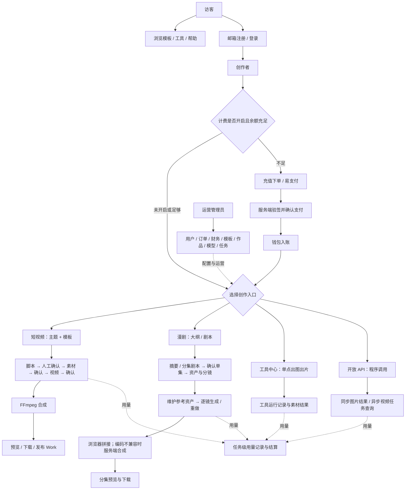

依据：`frontend/src/App.tsx`、`admin/src/App.tsx`、`backend/app/main.py`、`backend/app/api/projects.py`、`backend/app/api/drama/`、`backend/app/api/tools.py`、`backend/app/api/v1/generation.py`。

## 3. 技术架构总图

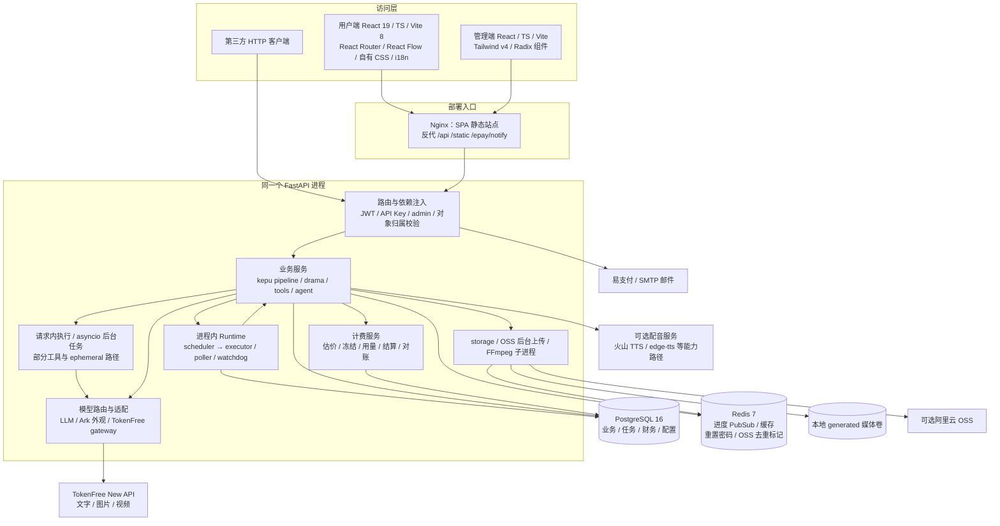

**边界解释**：AI 模型推理发生在上游；本服务做编排、适配、轮询、素材保存和合成。数据库是任务与资金的持久化事实来源。Redis 不是统一生成任务的 Celery broker；FFmpeg 是本服务调用的本地程序，不是外部转码平台。

## 4. 短视频业务：实际是分阶段确认

### 4.1 从创建到成片

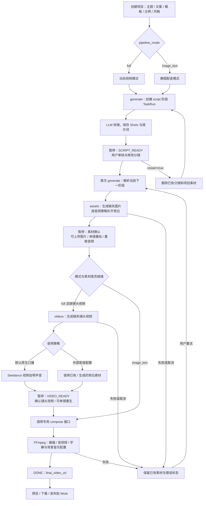

**重要约束**：

1. `generate` 首次仅产出脚本；之后每次执行一个计费阶段并暂停。素材齐备后，`generate` 返回“请点击合成成片”，合成走专用接口。
2. `resolve_kepu_billing_phase()` 是下一阶段的共同判定：无 shots → script；缺图或必需音频 → assets；full 缺视频 → videos；否则 compose。恢复与估价必须遵守同一套规则。
3. `full` 默认使用 Seedance 原生口播，不能把“所有视频都强制先 TTS”画成必经路径。`image_text` 不生成镜头视频，需要静图和旁白。
4. 被明确标记为隐私拦截跳过的视频镜头，可以用静图完成合成；就绪不总等于“有 video_url”。
5. 普通重试复用已有成果；`restart=true` 会删分镜与项目素材，属于重新生产。

源码入口：`api/projects.py:697`（生成）、`:1065`（单镜重绘）、`:1090`（重生视频）、`:1175`（合成）、`:1201`（发布）；`services/pipeline.py:396`（编排）、`:674`（脚本）、`:870`（图和音频）、`:1103`（视频）、`:1353`（合成）；`services/kepu_stages.py`（就绪规则）。

### 4.2 项目状态和执行状态不是同一状态机

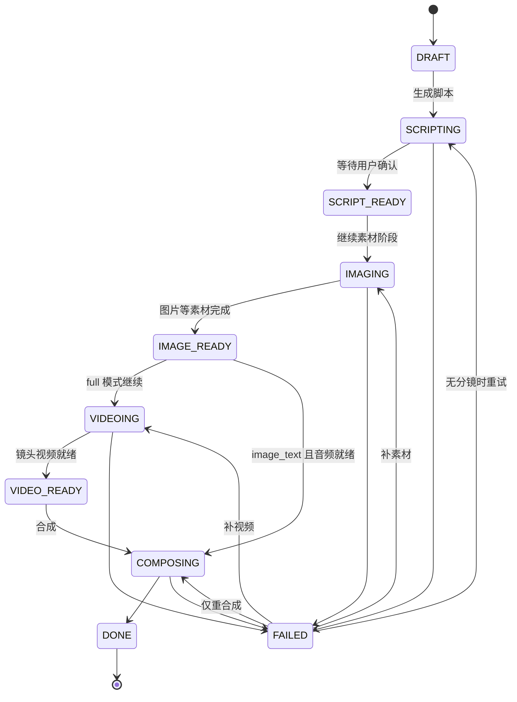

这张图展示主路径。枚举还包含 AUDIOING、AUDITING、REJECTED、CANCELLED，不能仅因枚举存在就认为当前所有生成都会经过审核服务。实际恢复结合素材和下一阶段计算；前端收到的事件阶段（如 ASSETS_READY）也不必与 ProjectStatus 字符串完全相同。

## 5. 漫剧业务：剧本、资产、分集、分镜

### 5.1 内容生产流程

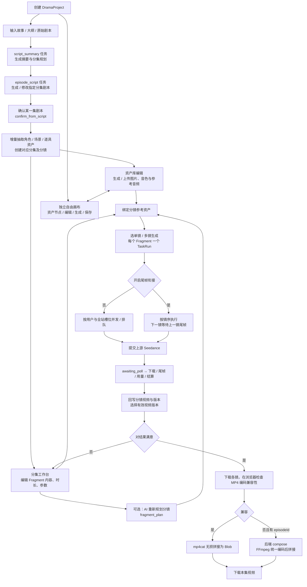

**对象层级**：剧项目 → 分集 Episode → 分镜 Fragment → 镜内 Beat（脚本中的 `@duration` 段）。Beat 是镜内节奏描述，不是独立 TaskRun。角色/场景/道具资产在项目范围复用，通过关联表绑定到分集与分镜。

**内容约束**：按 `docs/EPISODE_RULES.md`，一镜通常优先 8–20 秒、硬上限 30 秒；镜内段通常 3–12 秒，具体上游 duration 另有模型约束。开幕镜交代集号、标题与背景；画面/空镜、对白、旁白使用不同 cue，空镜不口播。最终参数还受模型预设和服务端校验约束。

**确认不是纯保存**：`confirm_from_script` 会锁定项目相关状态，增量抽取资产，创建/同步指定集内容，并通过 `run_billed_ephemeral` 记录执行与计费。不能把确认动作当成无成本的前端按钮。

**顺序不是纯展示顺序**：开启尾帧衔接时，分镜任务有 batch_key、batch_index 和 sequential 标记；上一镜失败会使后续依赖镜头停止，避免错误衔接。未开启时仍受并发槽位和预算限制。

**两种画布要分开理解**：`/drama/projects/:projectId/canvas` 是项目自由画布；`.../episodes/:episodeId/canvas` 是分集分镜画布。两者都用到节点编辑，但前者围绕资产创作，后者围绕分集叙事顺序与镜头生产。

依据：`api/drama/agents.py`、`api/drama/episodes.py:280`、`:420`、`:594`、`:852`；`services/drama/jobs.py`、`generation.py`、`fragment_plan.py`、`seed.py`、`build_fragments.py`；`frontend/src/lib/composeEpisodeVideoClient.ts:59`。

### 5.2 一次漫剧视频任务的时序

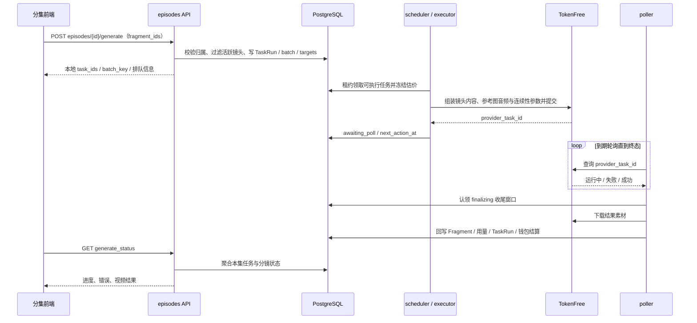

## 6. 统一任务平台与例外路径

### 6.1 运行时

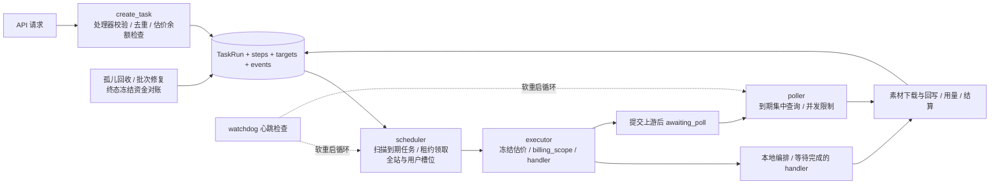

`main.py` 启动 `start_task_runtime()`，在同一个进程中启动 scheduler、poller 和 watchdog。执行器不需要单独部署；requirements 里的 Celery 不代表运行时正在使用 Celery。

`tasks/handlers.py` 的真实注册变量名是 **`TASK_HANDLERS`**（不是 CLAUDE.md 概括中的 `HANDLERS`）。五个 domain：kepu、drama、api、studio、tools。domain 是分类，不能据此推断所有任务都经过 scheduler。

### 6.2 必须区分的执行方式

- **持久化调度任务**：短视频流水线/单镜重做、漫剧剧本/资产/分镜任务等，通过 `create_task` 进入调度执行。
- **请求内 ephemeral**：部分 AI 对话、确认、开放 API 生图等，请求中执行业务，TaskRun 用于留痕、上下文计费与结算。注册 `_noop_ephemeral` 不代表功能尚未实现。
- **ephemeral deferred 视频**：开放 API / 工具视频在请求中提交上游，保存 provider_task_id 后进入等待；poller 和查询接口都具备推进结算的路径。
- **工具生图特别路径**：`studio_tools._dispatch_tool_image()` 直接 `asyncio.create_task(execute_image_tool_run(...))`，先以 ToolRun 排队，再在后台通过 `run_billed_ephemeral` 生成和计费。源码注释“统一任务平台”不能被理解成 scheduler 已接管其调度和重启恢复。
- **OSS 后台上传**：也是进程内 `asyncio.create_task`；Redis 存去重标记，不是一个独立持久化上传 Worker 队列。

因此，“离开页面仍继续”通常成立；“所有后台任务进程重启后都自动恢复”则不能一概而论。持久化任务有孤儿回收与重入机制，临时后台协程需要单独评估恢复性。

### 6.3 TaskRun 主状态

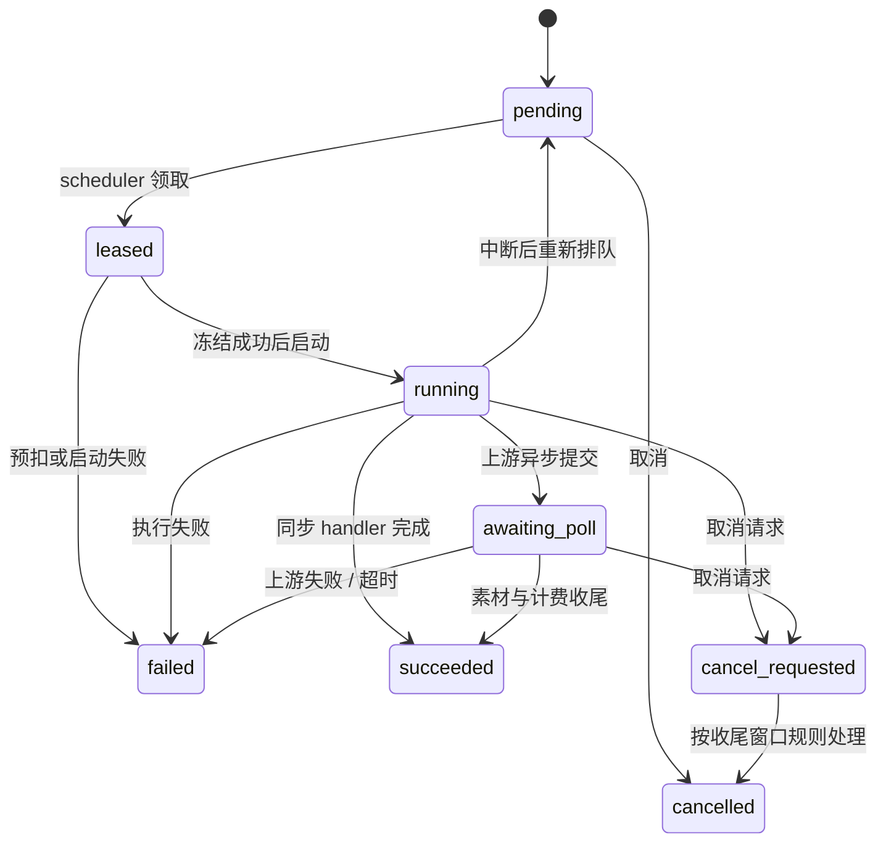

图为主路径，不是枚举的全部组合。`awaiting_review` 也被列为活跃态；`current_step_status`（如 submitting、polling、finalizing）是步骤状态，不能与 TaskRun.status 混用。finalizing 窗口保护下载和记账收尾，防止取消先退款、成果和用量随后落库。

## 7. 工具中心与开放 API

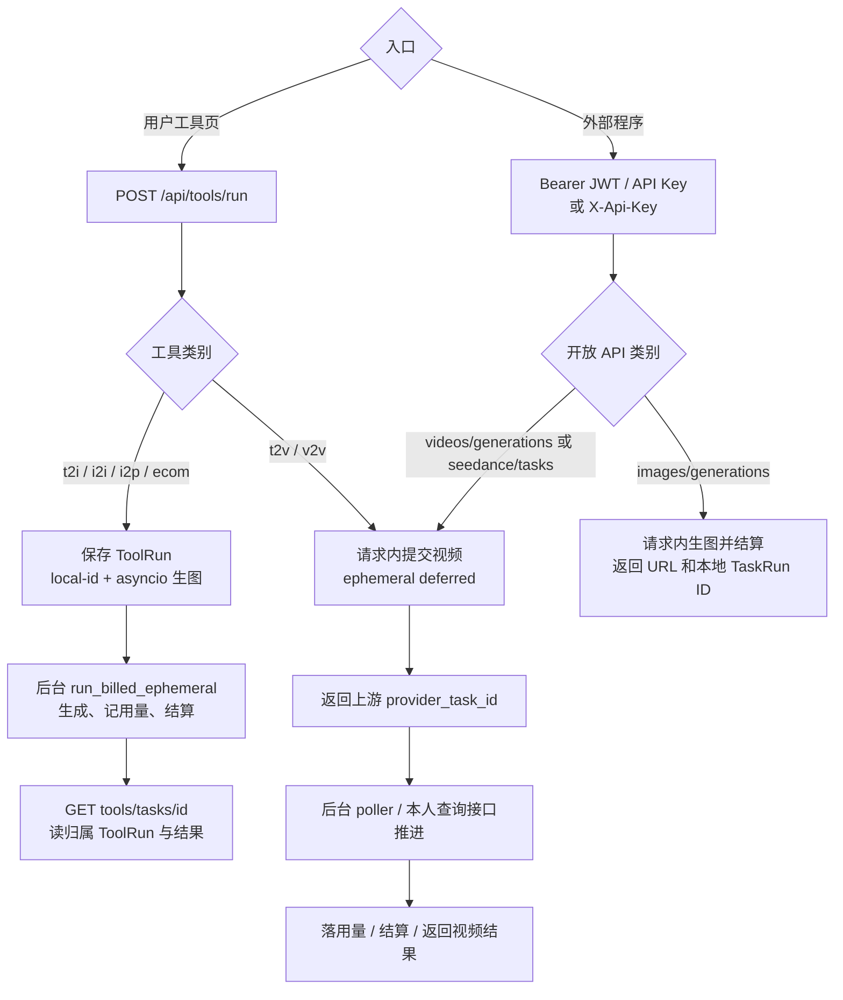

**ID 语义**：本地 `TaskRun.id` 是执行/计费标识；上游 `provider_task_id` 是 AI 平台标识；工具图片另有 `local-{run_id}`。开放 API 图片返回本地 ID，视频提交返回上游 ID。排查时先确认接口的 ID 语义，不要把它们互换。

**访问控制**：普通业务依赖 `get_current_user`；admin 额外检查 role；对象查询还要限制 user_id。开放 API 的查询校验 TaskRun.requested_by 与 provider_task_id 的对应关系；工具查询校验 ToolRun 归属，不能只凭一个上游任务 ID 代理查询。

## 8. 充值、计费与对账

### 8.1 充值链路

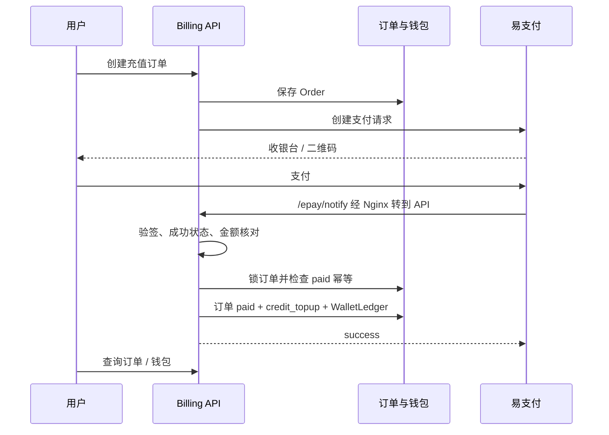

生产对外回调使用 `/epay/notify`，由 Nginx 映射到 `/api/billing/epay/notify`。前端支付完成页面不能替代服务端回调入账。

### 8.2 生成费用链路

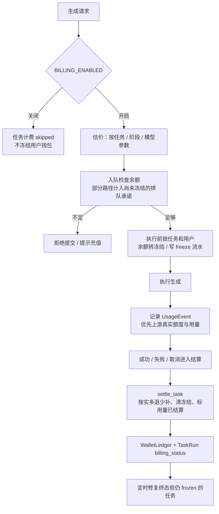

钱包单位是**分**，balance_fen 是可用余额，frozen_fen 是冻结金额。预扣本身会减少可用余额，结算不是简单“再扣一次全额”。

优先使用 TokenFree 真实 quota/用量；缺失时走本地估算与定价逻辑，涉及汇率、价格缓存和倍率。任务成功与否不是唯一计费依据：失败或取消时，如果上游已产生有效用量，需要按实际规则结算。不要承诺“一失败就全部退款”。

资金并发通过数据库行锁和任务结算幂等控制；scheduler 还会对“终态 + frozen”遗留任务补偿对账。计费默认关闭不代表上游调用免费，只表示不扣本系统用户钱包。

依据：`services/billing/settlement.py`、`ephemeral.py`、`usage.py`、`pricing.py`、`newapi_bill.py`；`api/billing.py:399`；专题细则见 `docs/BILLING.md`。

## 9. 核心数据关系图

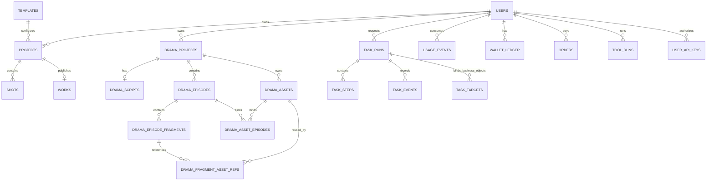

图表示主要业务基数，不声称图中所有逻辑连接都是数据库强外键。TaskRun 还带项目、分集、分镜、资产等上下文字段；UsageEvent 与 TaskRun 对应以支持任务结算。TaskTarget 通过类型与 ID 绑定对象，不应按一个普通单表外键理解。

- `models.py`：用户、模板、短视频项目/镜头、历史 PipelineJob、作品、用量、钱包、订单、工具运行。
- `models_drama.py`：漫剧项目、项目级单份剧本、资产、分集、分镜、资产关联。
- `models_tasks.py`：执行、步骤、目标、事件四类表。
- `models_settings.py`：AppSettings、SystemModelChannelRow，承载运行配置与渠道。
- `models_api.py`：用户 API Key；`models_agent.py`：导演/提示词 Skill 定义。

漫剧大量扩展信息在 `params` / `content` / `episode_content` JSON 内：任务展示状态、画布、生成参数、版本等字段不能只靠表列名理解，必须同时读服务和前端规范化逻辑。

## 10. 模型配置与媒体生命周期

### 10.1 配置到调用

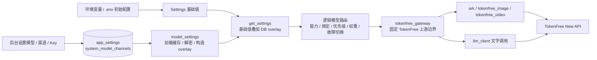

开源版不是任意上游的通用代理：上游协议与 Base URL 被 TokenFree 网关约束。路由可以选择逻辑模型/渠道绑定，但不意味着可以直接换成任意厂商地址。

DB overlay 优先于 env，因此“改了 .env 但模型没变”可能是后台配置覆盖。Key 加密依赖 secret_key 派生的 Fernet 密钥，备份迁移要保留相应配置。`ARK_MOCK=true` 走 mock，不验证真实模型能力。音频有独立实现与 Key/配置路径，不能把配音 Key 与图片视频 Key 混为一谈。

### 10.2 媒体到用户

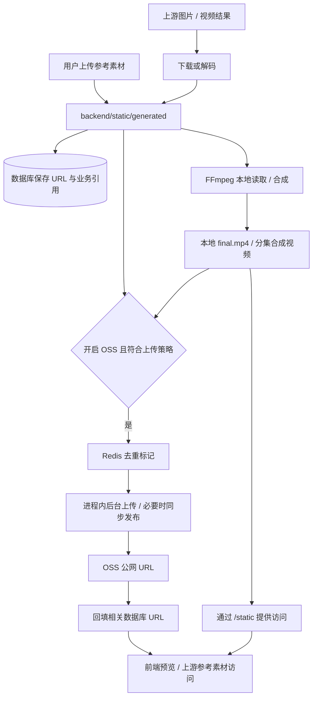

本地媒体卷不可随意删除：即使已有 OSS URL，FFmpeg 和恢复判定仍会用本地文件。科普流水线可跳过中间素材 OSS 发布，仅上传最终片；因此“数据库都是远程链接”与“所有素材均已备份到 OSS”都不成立。OSS 队列名称不能掩盖其进程内协程实现；补传脚本位于 `backend/scripts/backfill_oss_media.py`。

## 11. 启动与部署架构

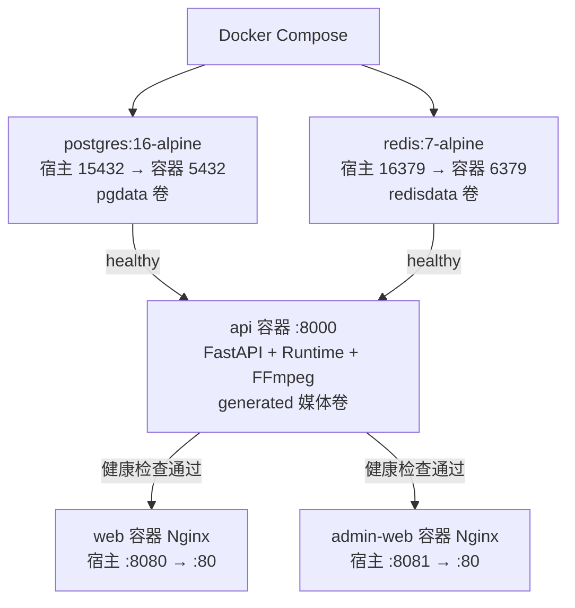

源码构建使用 `docker-compose.full.yml`；根 `docker-compose.yml` 使用预构建镜像；`deploy/docker-compose.yml` 主要用于中间件。不要混淆这三种入口。

开发时为三个应用进程：后端 :8000、用户端 Vite :5173、管理端 Vite :5174。用户端未配置 Vite API proxy，未设 `VITE_API_BASE` 时使用当前主机 :8000；设空字符串表示同源。管理端开发配置代理 `/api` 与 `/static`。

FastAPI 启动顺序：建表 → 增量 schema patch → 载入 DB 模型配置 → seed 模板 → 提权已注册 bootstrap 管理员 → seed Skill → 尝试 OSS CORS 配置 → 启动 Runtime。退出时先停 Runtime，再释放数据库连接池。

数据库不是 Alembic 迁移模式：`init_db/create_all` 加 `main._apply_schema_patches()`。不要认为改 ORM 自动会改已有列。模板 seed 主要补缺，不代表每次启动覆盖后台编辑。bootstrap 管理员只提升已存在的注册用户，不自动创建账号。

## 12. 前端、后台与代码阅读地图

### 12.1 用户端

入口是 `frontend/src/main.tsx` → `App.tsx` → 页面；请求在 `api.ts` 和 `api/`，纯业务转换在 `lib/`，可复用状态逻辑在 `hooks/`。样式是 `styles/printfilm.css` 与 pf-* 语义 class，语言资源在 `i18n/`。

- `/studio/new` → `CreateProjectPage`：建立短视频项目。
- `/studio/:id/style` → `StyleConfigPage`：风格配置。
- `/studio/:id` → `StoryboardPage`：分镜、分阶段生成和进度。
- `/studio/:id/editor` → `EditorPage`：编辑入口。
- `/drama/projects/:projectId` → `ProjectWorkspacePage`：漫剧剧本/项目工作台。
- `/drama/projects/:projectId/episodes/:episodeId` → `EpisodeEditPage`：分集与镜头生产。
- 两种 canvas 路由分别连接项目资产画布和分集分镜画布。
- `/tools/:toolId` → `ToolDetailPage`：单点工具；`/settings`、`/pricing` 涉及账户、API Key 和钱包相关交互。

短视频前端在运行时轮询项目；后端也提供 `/projects/{id}/events` SSE，Redis/本地队列支持进度广播。**存在 SSE 接口不等于当前页面全部用 SSE**。漫剧的全局队列组件与 `lib/dramaGenQueue.ts` 负责跨页面展示/轮询，服务端任务才是执行事实来源。

### 12.2 管理端

`admin/src/App.tsx` 的 `RequireAdmin` 做前端入口限制；真正权限仍由后端 `get_current_admin` 校验。后台包括用户、订单、财务、短视频项目、漫剧项目/分集/分镜/资产、作品、模板、任务中心与设置。

`/queues` 读取 TaskRun 平台信息，不能理解成 Celery broker 控制台。模型设置影响全部业务，模板影响新项目/分镜的默认风格和生成约束，财务聚合服务负责查看账务与上游消耗。

### 12.3 推荐阅读顺序

1. **入口与边界**：`backend/app/main.py`、`deps.py`、`database.py`、`frontend/src/App.tsx`。
2. **业务对象**：`models.py`、`models_drama.py`、`models_tasks.py`，对照第 9 节图。
3. **跑通一条短视频链路**：`api/projects.py:697` → `tasks/service.py` → `tasks/handlers.py:150` → `pipeline.py:396` → `kepu_stages.py`。
4. **跑通一条漫剧链路**：`api/drama/agents.py` → `episodes.py:280` / `:594` → `drama/jobs.py` → `drama/generation.py` → `tasks/poller.py`。
5. **理解钱从哪来、到哪去**：`api/billing.py` → `billing/ephemeral.py` / `settlement.py` → `usage.py` / `newapi_bill.py`。
6. **理解真实上游与结果**：`model_settings.py` → `logical_model_router.py` → `tokenfree_gateway.py` → `ark.py` / `llm_client.py` → `storage.py`。
7. **回到交互**：`StoryboardPage.tsx`、`EpisodeEditPage.tsx`、`lib/dramaGenQueue.ts`、`lib/composeEpisodeVideoClient.ts`、画布 Store 与 normalize helper。

## 13. 实际排查问题时沿哪条线走

- **点生成没反应**：浏览器请求/错误 → 对象归属和余额 → TaskRun 是否创建 → pending/next_action_at/槽位 → scheduler 心跳 → handler 注册。
- **一直显示生成中**：区分本地 TaskRun ID 与 provider_task_id → 查看步骤 polling/finalizing → 上游状态 → 下载/本地磁盘 → 业务回写。工具图片先查 ToolRun 和后台协程路径。
- **某集后面的镜头不执行**：先看是否尾帧串行，再看上一镜结果、尾帧和 sequential 批次状态，不要先提高并发。
- **素材齐了仍不能下一步**：看 `kepu_stages` 音频文件存在性与静音判定、视频 privacy skip、运行中的侧任务，以及是否需要专用 compose 接口。
- **扣费不符合预期**：TaskRun phase / 估价 / frozen → UsageEvent 的真实上游值与估算来源 → settle_task → WalletLedger；不要只看订单或前端金额。
- **改模型不生效**：查 DB overlay、逻辑模型绑定、网关限制、缓存刷新，再查 env。
- **能预览但合成失败**：先查本地媒体文件、FFmpeg/ffprobe 与编码/画幅；漫剧再区分浏览器 MP4 兼容性与服务端回退。

## 14. 理解架构时需要保留的边界

1. **Web 与后台执行耦合**：API 重启会影响同进程 Runtime 与临时协程；持久化任务有恢复设计，但不能据此宣称所有工作都可无损恢复。
2. **水平扩容需要重新核对**：调度含数据库租约，但槽位计数、看门狗和部分状态在进程内，启动 schema patch 也有并发影响。不能简单多开 uvicorn worker 就认定实现了全局统一限流和安全扩容。
3. **外部服务与本地磁盘共同影响成功**：上游成功后仍有下载、尾帧、FFmpeg、OSS 回填和账务收尾，不能仅以 AI 返回成功定义业务成功。
4. **业务和资金两套状态都要收敛**：TaskRun、Project/Fragment、UsageEvent 和钱包需要对齐；finalizing 和终态冻结对账正是为跨步骤不一致提供保护。
5. **说明文档有历史痕迹**：Celery 依赖、PipelineJob、函数注释和部分抽象命名保留旧表述。本报告把工具生图、OSS 上传、阶段暂停等按当前代码展开，后续改动应重新核对。

本次交付仅新增说明文档与图稿，不修改业务逻辑。结论来自路由、服务、模型、前端与部署文件交叉核对；没有宣称真实上游、支付、OSS、所有错误分支已通过运行测试。

## 15. 下游数字资产市场架构（2026-10-23）

数字资产市场是挂载在同一 FastAPI 进程里的独立业务模块，不是微服务。用户端和管理端分别通过 `/api/marketplace/*`、`/api/admin/marketplace/*` 访问；仅复用账号、管理员身份和后台 OSS 配置。新增 SQLAlchemy metadata 的表都使用 `marketplace_` 前缀，不能读取或改写原 AI、计费、漫剧任务表。

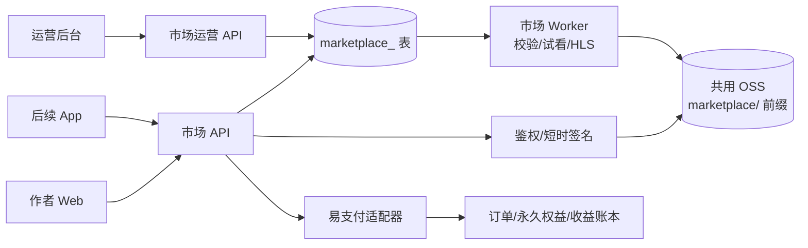

业务对象分为单视频 `Work`、短剧 `Series` 及分集 `SeriesEpisode`。每次提交审核生成 `Publication` 快照，订单和播放权益绑定快照版本，视频、权属、收费类型或价格修改后不会覆盖旧版本。收费类型为免费原片、客服版权试看、平台投放永久解锁；作品与版权信息一次提交、一次管理员审核。短剧导入只在用户明确选择本人漫剧成片后复制到市场 OSS，并保存来源快照，原漫剧后续修改不会回写市场。

市场 Worker 与原项目 Worker 分开使用任务表和租约，但由 API 自动启停和看门狗恢复。免费内容无需转码；付费客服内容生成不超过 15 秒且不超过 30% 的高保真烧录水印试看；平台投放审核通过后生成同源分辨率 HLS。播放每次重新鉴权，付费接口不返回原片对象地址。OSS、支付和 App 播放未配置时只能验证错误码和权限边界，不能把本地替身结果当作线上验收。

阅读市场代码建议按以下顺序：`backend/app/marketplace/models.py`（表与版本）、`schemas.py`（请求约束）、`series.py`/`api.py`（作者流程）、`admin.py`（一次审核与运营）、`preview_worker.py`/`worker.py`（媒体任务）、`commerce.py`（订单/权益/播放）、`storage.py`（私有 OSS 适配），再看 `frontend/src/features/marketplace` 与 `admin/src/features/marketplace` 的页面接线。